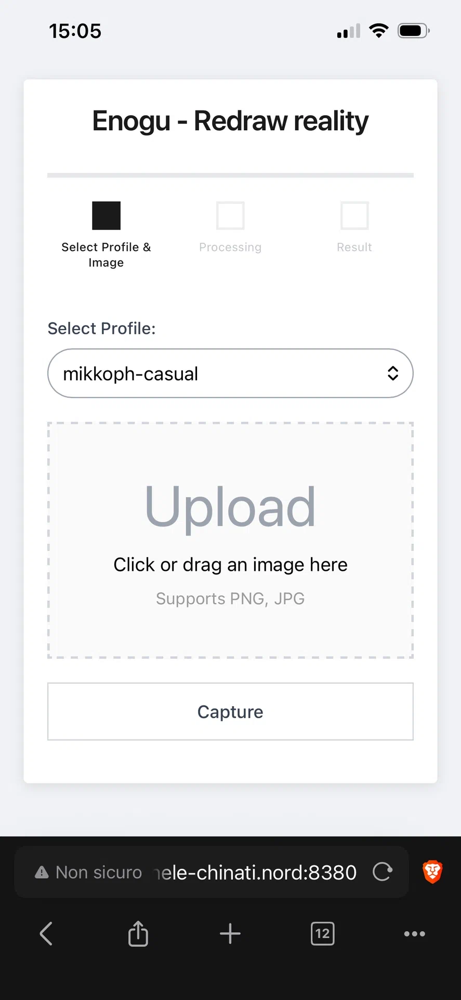

# Enogu - Redraw Reality

> **Note** This project is vibecoded using various models (Qwen3.5-35B-A3B, Qwen3.5-122B-A3B, Qwen3.6-35B-A3B, Qwen3.6-27B, DeepSeek-V4-Flash-0731) with different tools (RooCode, KiloCode, OpenCode, pi) via Lemonade. It is a test bench to test new harnesses and models. It also happens to scratch an itch I had an am having lots of fun using it but that doesn't mean that it will be useful to you.

A web application that processes uploaded images through an LLM for analysis and generates new images via the same OpenAI-compatible endpoint. The application supports multiple **profiles** (LLM analysis prompts) and **presets** (generation parameter sets). When you upload a reference image, the profile's "extraction" prompt is sent to the LLM along with the image to produce an image-generation prompt; that prompt is then sent to the OpenAI-compatible endpoint along with the selected preset's generation parameters. By playing with the extraction prompt you can have the LLM generate interesting prompts, which makes the whole thing quite fun to use.

## Features

- Image upload and analysis using LLM with tool calling
- Automatic prompt extraction from uploaded images
- Image generation via the OpenAI-compatible endpoint (same endpoint used for analysis)
- Separate **profile** (LLM extraction prompt) and **preset** (generation parameters) management
- Aspect ratio selection (1:1, 3:4, 4:3, 9:16, 16:9, 9:20, 20:9 in portrait/landscape)
- **Resolution targeting**: each preset defines a target resolution in megapixels (1 MP = 1024x1024 pixels); the concrete size for the selected ratio is computed by the UI
- Boolean upscaling support (2x latent upscale, on/off)
- Image history (last 10 generated images)
- Re-analyze and regenerate capabilities
- **Gallery** for saving and browsing generated images
- In-app editors for profiles, presets, and provider configuration (with LLM model refresh)
- Mobile-friendly with camera capture support

## Demo



## Prerequisites

- Python 3.10 or higher
- [uv](https://github.com/astral-sh/uv) package manager (recommended)
- An OpenAI-compatible endpoint that serves both chat completions (for analysis) and image generation

## Installation

Using `uv` (recommended):

```bash
uv sync
```

This will create a virtual environment and install all dependencies defined in `pyproject.toml`.

## Configuration

### Global Configuration

Create a `config.json` file in the project root (use `config.template.json` as a starting point):

```json
{
    "server": {
        "host": "0.0.0.0",
        "port": 8380
    },
    "providers": {
        "llm_endpoint": "http://localhost:8000/api/v1",
        "llm_apikey": "your-api-key",
        "llm_model": "user.Qwen3.5-35B-A3B-NoThinking",
        "system_prompt": ""
    }
}
```

Missing keys fall back to defaults, and writes are atomic.

### Profile Configuration

Profiles are stored in the `profiles/` directory. Each profile directory contains only:

- `extraction_prompt.txt` - Prompt template for LLM image analysis

Profiles control how the LLM analyzes an image and what prompt it produces.

### Preset Configuration

Presets are stored in the `presets/` directory. Each preset directory contains only:

- `settings.json` - Generation parameters that do not change per-request

A preset configures the generation parameters that stay fixed across requests (e.g. `model`, `steps`, `cfg_scale`, `sampler`, `negative_prompt`, `lora_specs`). The per-request parameters (`prompt`, `seed`, `width`, `height`, `upscale`) are filled in by the app when you generate.

Example `presets/anima-mikkoani/settings.json`:

```json
{
    "model": "Anima-Base",
    "negative_prompt": "worst quality, low quality, ...",
    "steps": 20,
    "cfg_scale": 4.0,
    "sampler": "er_sde",
    "target_megapixels": 1.0,
    "qwen_vae_enhance": true,
    "film_grain": 0,
    "sharpening": 0.5,
    "lora_specs": ["anima-mikkoani-v3.1:1.0"]
}
```

The full set of accepted parameters (sent as regular JSON to the generation endpoint) is: `model`, `prompt`, `seed`, `steps`, `cfg_scale`, `width`, `height`, `sampler` (`euler | er_sde`), `negative_prompt`, `upscale` (boolean), `qwen_vae_enhance` (boolean), `film_grain`, `sharpening`, `lora_specs`. Additional custom fields are passed through as-is, **except** `target_megapixels` and `resolution_divisor`: those are app-level resolution settings (see below) and are stripped before the request is sent.

### Resolution Targeting

Instead of fixed pixel sizes, a preset declares a **target resolution in megapixels**, where **1 MP = 1024 x 1024 pixels** (1,048,576 px):

- `target_megapixels` (optional, default `1.0`) - the pixel budget every aspect ratio is normalized to, so switching ratio no longer changes how much detail you get
- `resolution_divisor` (optional, default `8`) - both sides are rounded to a multiple of this (VAE tile size); use `16`/`32` for models that need coarser alignment

The target is stored on the server and served by `GET /api/presets`; the **frontend** turns it into a concrete `width`/`height` (`frontend/resolution.js`) and sends those to `/api/generate`, which generates exactly the size it is given. The size the next generation will use is shown under the aspect-ratio selector.

Sizes at `target_megapixels: 1.0` (divisor 8):

| Ratio | 1x | 1.5x | 2x |
|-------|----|------|----|
| 1:1 | 1024x1024 | 1536x1536 | 2048x2048 |
| 3:4 | 888x1184 | 1328x1768 | 1776x2368 |
| 4:3 | 1184x888 | 1768x1328 | 2368x1776 |
| 9:16 | 768x1368 | 1152x2048 | 1536x2728 |
| 16:9 | 1368x768 | 2048x1152 | 2728x1536 |
| 9:20 | 688x1528 | 1032x2288 | 1376x3056 |
| 20:9 | 1528x688 | 2288x1032 | 3056x1376 |

The `1.5x` / `2x` buttons scale **per side**, so `1.5x` is 2.25x the megapixels and `2x` is 4x. The `Upscale and save` button keeps the size of the current generation and turns on the endpoint's 2x latent upscaler (the preset target still decides the requested size).

## Running the Application

```bash
uv run python app.py
```

The server will start on `http://localhost:8380` (or the port specified in `config.json`).

## API Endpoints

| Method | Endpoint | Description |
|--------|----------|-------------|
| GET | `/` | Serves the frontend application |
| GET | `/api/profiles` | Lists all available profiles |
| GET | `/api/presets` | Lists all available presets (with their target resolution) |
| POST | `/api/analyze` | Analyzes an uploaded image and returns a generation prompt |
| POST | `/api/generate` | Generates an image from a prompt using the OpenAI-compatible endpoint |
| GET | `/api/gallery` | Lists saved generated images |
| GET | `/api/gallery/{filename}` | Downloads a saved image |
| DELETE | `/api/gallery` | Deletes all saved images |
| DELETE | `/api/gallery/{filename}` | Deletes a saved image |
| GET/POST | `/api/profile-editor/profile` | Get / save a profile |
| POST | `/api/profile-editor/profile/duplicate` | Duplicates a profile |
| DELETE | `/api/profile-editor/profile/{name}` | Deletes a profile |
| POST | `/api/profile-editor/profile/rename` | Renames a profile |
| GET | `/api/profile-editor/download/...` | Downloads profiles as ZIP |
| GET/POST | `/api/preset-editor/preset` | Get / save a preset |
| POST | `/api/preset-editor/preset/duplicate` | Duplicates a preset |
| DELETE | `/api/preset-editor/preset/{name}` | Deletes a preset |
| POST | `/api/preset-editor/preset/rename` | Renames a preset |
| GET | `/api/preset-editor/download/...` | Downloads presets as ZIP |
| GET/POST | `/api/config/providers` | Gets / updates provider configuration |
| GET | `/api/config/models` | Fetches available LLM models |

### Core Generation Endpoints

- `POST /api/analyze`
  - `file`: UploadFile - The image to analyze
  - `profile`: str - Profile name to use
  - Returns: `{"success": true, "prompt": "..."}` or error
- `POST /api/generate`
  - `prompt`: str - The generation prompt
  - `preset`: str - Preset name to use
  - `width`: int (default: 1024) - Image width (computed by the frontend from the preset's `target_megapixels` x the selected ratio; used as given)
  - `height`: int (default: 1024) - Image height (as above)
  - `seed`: int (default: -1) - Seed value
  - `upscale`: bool (default: false) - Enable 2x latent upscaling
  - `save`: bool (default: false) - Save to the gallery
  - Returns: `{"success": true, "image": "data:image/png;base64,..."}` or error

## Frontend Features

- **Generate View**: Select a profile + preset, upload an image, and run the analyze → generate flow
- **Image Upload**: Drag-and-drop or click to upload images
- **Mobile Camera**: Direct camera capture on mobile devices
- **Aspect Ratio Selection**: Choose from predefined ratios (1:1, 3:4, 4:3, 9:16, 16:9, 9:20, 20:9)
- **Resolution Read-out**: Shows the target resolution of the selected preset and the exact size (and megapixels) the next generation will use
- **Upscaling**: Optional boolean 2x upscaling (on/off)
- **Image History**: View last 10 generated images
- **Re-analyze**: Re-run LLM analysis on the same image
- **Regenerate**: Generate a new image with the same prompt
- **Profile Editor**: Create/rename/duplicate/delete profiles and edit their extraction prompt
- **Preset Editor**: Create/rename/duplicate/delete presets and edit their `settings.json`
- **Config Editor**: Edit the OpenAI-compatible endpoint/key/model and refresh the LLM model list
- **Gallery**: Browse, download, and delete saved generated images

## Running the Tests

Backend (pytest):

```bash
python -m pytest tests/ -v
```

Tests cover name validation, image processing, profile/preset managers, preset resolution targeting, and the LLM service (with mocked HTTP).

Frontend (Node's built-in test runner, no dependencies to install, Node >= 22):

```bash
npm test
```

Tests cover `frontend/resolution.js` (megapixel math, per-side scaling, divisor alignment, fallbacks) and keep the aspect-ratio `<select>` in sync with the ratio table.

## Dependencies

- **FastAPI** - Async web framework for the API
- **Uvicorn** - ASGI server
- **httpx** - Async HTTP client for calling the LLM endpoint
- **Pillow** - Image manipulation and resizing
- **python-multipart** - Handling file uploads in forms
- **Pydantic** - Request/response validation

## Project Structure

```
imagegen/
├── app.py              # Entry point
├── app/                # Backend package
│   ├── main.py         # FastAPI app setup, middleware, exception handlers
│   ├── config.py       # Configuration loading, constants, providers management
│   ├── models.py       # Pydantic request/response models
│   ├── routes/         # API route handlers (generation, gallery, profiles, presets, config)
│   ├── services/       # Business logic (llm, preset, profile)
│   └── utils/          # Shared utilities (files, image, validation)
├── config.json         # Global configuration (created from config.template.json)
├── config.template.json # Configuration template
├── pyproject.toml      # Project dependencies
├── package.json        # JS test runner config (no runtime JS dependencies)
├── tests/              # Unit tests (pytest) + tests/js (node --test)
├── frontend/           # Static frontend files (ES modules)
│   ├── index.html      # Main HTML page
│   ├── main.js         # Entry point, navigation, event binding
│   ├── api.js          # API call functions
│   ├── state.js        # State management and DOM registry
│   ├── resolution.js   # Aspect ratios + megapixel -> width/height math
│   ├── ui.js           # UI operations and dialog components
│   ├── refresh.js      # Shared data-loading / refresh helpers
│   ├── editor.js       # Shared editor operation executor
│   ├── profile-editor.js # Profile editor logic
│   ├── preset-editor.js # Preset editor logic
│   ├── config-editor.js  # Configuration editor logic
│   ├── history.js      # Image history management
│   └── styles.css      # CSS styling
├── profiles/           # Prompt profiles (extraction_prompt.txt per profile)
└── presets/            # Generation presets (settings.json per preset)
```

## Security Note

This is a local/LAN toy project. There is **no authentication** on any endpoint, including the config endpoints that read/write API keys, and CORS is wide open. If deployed beyond a trusted LAN, add authentication and restrict CORS.

## License

MIT
